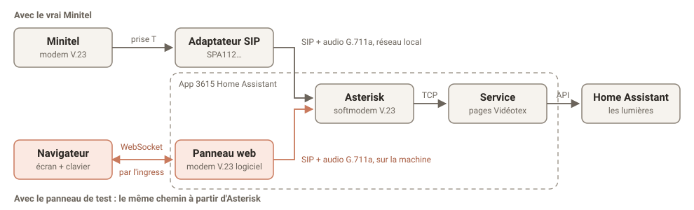

# Développement

Pour faire tourner 3615 Home Assistant sans Home Assistant OS, le tester, le diagnostiquer, ou comprendre comment il marche. Pour installer l'app, voir le [README](README.md) ; pour la configurer, [la documentation de l'app](minitel/DOCS.md).

```
Minitel ── prise T ── adaptateur SIP ── SIP, G.711a ── Asterisk + app_softmodem ── TCP ── service Python ── WebSocket ── Home Assistant
```

Une connexion TCP = un appel Minitel = une session. Fermer le socket fait raccrocher l'appel.

## Sans Home Assistant OS (Docker)

Sur une machine Linux avec Docker, sur le réseau local. Asterisk et le service tournent alors dans deux conteneurs, et joignent Home Assistant par son API avec un jeton.

1. Créer un jeton dans Home Assistant, avec un compte administrateur (il lit la liste des tableaux de bord et les registres) : profil > Sécurité > Jetons d'accès longue durée.
2. Préparer la configuration, puis démarrer :

   ```bash
   cp .env.example .env              # HA_URL, HA_TOKEN, SIP_PASSWORD, LAN_CIDR
   cp minitel.example.yaml minitel.yaml
   docker compose up -d --build
   docker logs minitel-service       # le tableau de bord choisi, puis « en écoute »
   ```

3. Configurer l'adaptateur comme dans [la documentation de l'app](minitel/DOCS.md#réglages-de-ladaptateur), à deux différences près : le Proxy est l'adresse de la machine Docker, et le mot de passe est le `SIP_PASSWORD` du `.env`. Puis vérifier qu'il s'enregistre :

   ```bash
   docker exec minitel-asterisk asterisk -rx 'pjsip show contacts'
   ```

Le titre et le tableau de bord se choisissent dans `minitel.yaml`, puis `docker compose restart minitel-service`. Les journaux d'Asterisk : `docker logs -f minitel-asterisk`. Le panneau de test n'existe qu'avec l'app : en Docker, le service ne partage pas le réseau d'Asterisk.

## Tests

```bash
cd minitel/service
uv run --group dev pytest
uv run --group dev ruff check . ../../tools
```

Ils font aussi tourner le modem logiciel et le panneau face à un faux Asterisk ([tests/fake_asterisk.py](minitel/service/tests/fake_asterisk.py)).

## Outils

- **[tools/fake_minitel.py](tools/fake_minitel.py)** remplace le Minitel et l'adaptateur en ligne de commande : il s'enregistre en SIP, appelle le 3615 et affiche l'écran reçu. Il tourne sur la machine d'Asterisk, avec `LAN_CIDR=127.0.0.0/8` : `SIP_PASSWORD=... python tools/fake_minitel.py`.
- **Vidéotex brut en TCP :** en Docker, avec `VIDEOTEX_BIND=0.0.0.0`, on peut connecter un émulateur Minitel TCP au port 3615. Remettez `127.0.0.1` ensuite : le service n'a pas d'authentification.
- **[tools/rtp_analyze.py](tools/rtp_analyze.py)** analyse un appel capturé avec `tcpdump` sur la machine d'Asterisk. Il donne le niveau et les fréquences de chaque sens : le 390 Hz est la réponse du Minitel.

## Niveau de la porteuse

Si le `C` clignote 40 s puis revient à `F` alors que le branchement et l'adaptateur sont bons, le niveau `t(-8)` de [minitel/asterisk/extensions.conf](minitel/asterisk/extensions.conf) est à ajuster (essayer `t(-14)`, puis `t(-4)`), avec au besoin `r(-40)` pour la sensibilité de réception. Ce réglage n'est pas exposé dans l'app : il faut reconstruire l'image, en copiant le dossier `minitel` dans `/addons` pour l'installer comme app locale, ou avec la version Docker. Dites-le dans une issue si votre matériel en a besoin.

## Notes techniques

- Une seule recette, [minitel/Dockerfile](minitel/Dockerfile) : Home Assistant construit la dernière étape (Asterisk et le service dans un conteneur, lancés par [run.sh](minitel/run.sh)), docker-compose choisit les autres avec `target`.
- Seul `app_softmodem.c` est compilé, contre le paquet Ubuntu `asterisk-dev` (Asterisk 20.6), à une révision figée dans le Dockerfile. `-DASTMM_LIBC=ASTMM_IGNORE` est requis pour que les en-têtes spandsp compilent, comme pour `res_fax_spandsp` dans Asterisk.
- `app_softmodem` décale sa lecture de 10 bits par octet reçu, en dur. Ça tombe juste pour le 7E1 (start + 7 + parité + stop), mais pas pour d'autres formats.
- `modules.conf` liste les modules un par un et `manager.conf` coupe l'interface AMI : en réseau hôte, rien d'autre que le SIP et le RTP ne doit écouter.
- Le service n'a pas d'authentification et ne doit jamais être exposé : il n'écoute que sur `127.0.0.1`.

### Le tableau de bord

- [hass.py](minitel/service/minitel_ha/hass.py) tient une seule connexion WebSocket à Home Assistant pour tout le service. Il choisit le tableau de bord (`lovelace/dashboards/list`, le tableau par défaut dans `frontend/get_system_data`), le traduit, et s'abonne aux états de ses seules entités (`subscribe_entities`). Il recharge sur `lovelace_updated`, ou sur les événements des registres en mode « pièces », et se reconnecte seul.
- [dashboard.py](minitel/service/minitel_ha/dashboard.py) traduit la configuration d'un tableau de bord (`lovelace/config`) en vues, titres et entités, ou génère une page par pièce. Il garde les conditions de visibilité, évaluées avec les états du moment. Rien n'y fait d'entrée ou de sortie.
- [render.py](minitel/service/minitel_ha/render.py) découpe une vue en écrans de 16 rangées, numérote ce qu'on peut commander, écrit les états en texte et choisit le service à appeler pour chaque touche.
- [session.py](minitel/service/minitel_ha/session.py) compare les rangées recalculées à chaque changement avec ce qui est affiché, et n'envoie que celles qui diffèrent : à 1200 bauds, un écran plein met 3 à 4 secondes. Une valeur en double taille déborde sur la rangée du dessus, qu'il faut alors reprendre aussi.
- Le format des événements de `subscribe_entities` (`a` ajout, `c` différences `+` / `-`, `r` suppression) n'est pas documenté ailleurs que dans le code de Home Assistant (`websocket_api/messages.py`).
- Le softmodem peut prendre l'écho de sa propre porteuse pour la réponse du Minitel, et envoyer la page un peu tôt. Ça n'a pas gêné sur le matériel testé.

### Le panneau de test



- Un serveur aiohttp dans le service ([web.py](minitel/service/minitel_ha/web.py)), sur le port d'ingress 3616. L'app étant en réseau hôte, ce port est ouvert sur le réseau local : le serveur refuse tout ce qui ne vient pas du Supervisor (`172.30.32.2`).
- Le navigateur n'affiche que l'écran et envoie les touches par WebSocket. L'appel part du service : SIP ([sip.py](minitel/service/minitel_ha/sip.py)) sur le compte `minitel-web`, réservé à `127.0.0.1` avec un mot de passe tiré à chaque démarrage, puis RTP G.711a et modem V.23 logiciel ([line.py](minitel/service/minitel_ha/line.py), [modem.py](minitel/service/minitel_ha/modem.py)).
- Pas de WebRTC dans le navigateur : son tampon de gigue étire le son pour masquer les pertes, ce qui déforme une porteuse FSK, et l'audio en UDP ne passerait pas par l'ingress.
- Le modem démodule le 1200 bauds par DFT glissante sur une fenêtre d'un bit, et attend 50 ms de porteuse avant de lire, pour ignorer le silence et la tonalité du début d'appel.
- L'écran ([static/minitel.js](minitel/service/minitel_ha/static/minitel.js)) interprète le Vidéotex (positionnement, attributs, G2, mosaïques G1, répétition) et dessine une police matricielle 5 × 7 dans des cases de 8 × 10 points, en niveaux de gris comme le Minitel 1.
