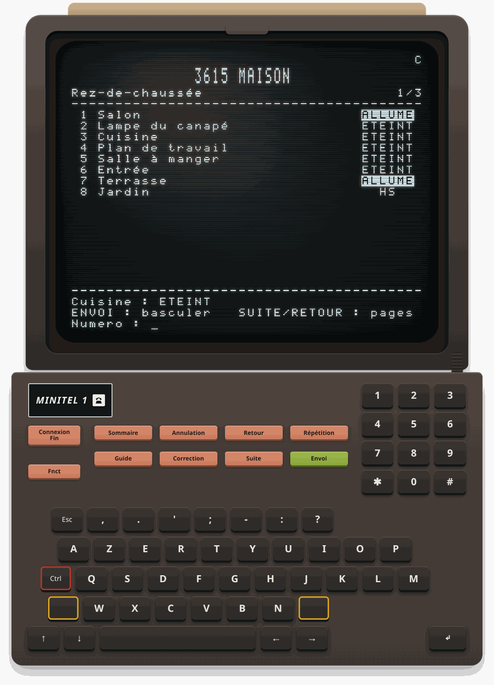
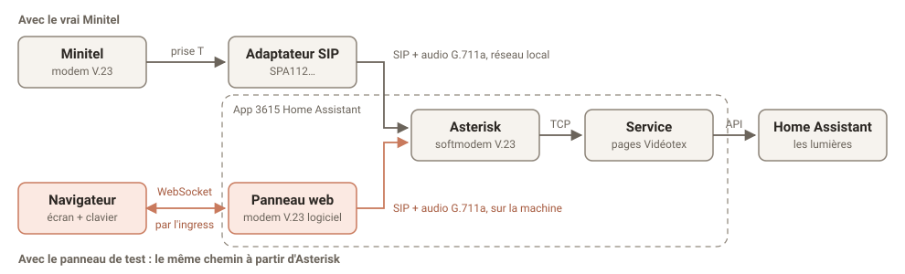

<p align="center"></p>

# 3615 Home Assistant

**Vos tableaux de bord Home Assistant sur un vrai Minitel, par sa ligne téléphonique.** On décroche, la porteuse siffle, le sommaire s'affiche : lumières, volets, chauffage, températures, à jour en direct. On tape un numéro puis ENVOI. Comme en 1985, mais pour piloter Home Assistant : 100 % en local, sans rien ajouter au Minitel.

*Show your Home Assistant dashboards on a real French Minitel and control your home over its phone line: an analog telephone adapter, Asterisk with a V.23 softmodem, and a small Videotex server, all in one Home Assistant app. The documentation is in French; ask in an issue if you need help in English.*

<p align="center"></p>

<p align="center"><em>Pas encore de Minitel sous la main ? L'app en met un dans la barre latérale de Home Assistant, qui appelle par le même chemin que le vrai.</em></p>

Projet personnel non officiel, sans lien avec Home Assistant. Testé avec un Minitel 1 Alcatel et un Cisco SPA112 : tout retour sur un autre matériel est bienvenu.

## Comment ça marche



Le Minitel appelle le 3615 par un adaptateur SIP. Dans l'app, Asterisk décroche, et son softmodem V.23 parle au Minitel comme un serveur des années 80. Le service dessine les pages en Vidéotex et bascule les lumières par l'API de Home Assistant. Le panneau de test prend le même chemin à partir d'Asterisk : s'il marche, il ne reste à vérifier que l'adaptateur et le fil.

## Il vous faut

- **Home Assistant OS**, sur aarch64 ou amd64.
- **Un Minitel**, avec sa fiche téléphonique en T.
- **Un adaptateur téléphonique SIP (ATA)**, par exemple un Cisco SPA112, facile à trouver d'occasion.
- **Une prise T femelle reliée à un RJ11 mâle** : un adaptateur tout fait, ou une prise murale en T câblée à la main.

## Démarrer

### 1. Installer l'app

[](https://my.home-assistant.io/redirect/supervisor_add_addon_repository/?repository_url=https%3A%2F%2Fgithub.com%2Fenavarro222%2F3615HomeAssistant)

Ajoutez le dépôt avec ce bouton (ou à la main : Paramètres > Apps > boutique > ⋮ > Dépôts, `https://github.com/enavarro222/3615HomeAssistant`), puis installez **3615 Home Assistant**. L'image se construit sur place : une dizaine de minutes sur un Raspberry Pi.

### 2. Choisir ce qui s'affiche

Le Minitel affiche un tableau de bord de Home Assistant : ses vues forment le sommaire, ses cartes deviennent des lignes. Sans réglage, c'est le tableau de bord par défaut. Pour un résultat taillé pour 40 colonnes, dupliquez un tableau de bord (Paramètres > Tableaux de bord), gardez l'essentiel, et reportez son adresse dans l'onglet Configuration de l'app. Passez en YAML (⋮ > Modifier en YAML) :

```yaml
title: 3615 MAISON
dashboard: maison-minitel        # vide : le tableau de bord par défaut
sip_password: ChoisissezUnMotDePasse42   # lettres et chiffres, à reporter dans l'adaptateur
lan_cidr: ""                             # vide : le réseau local est détecté
```

Démarrez l'app : le panneau **Minitel** apparaît dans la barre latérale. Appuyez sur **Connexion/Fin** : si le sommaire s'affiche, l'app marche. Ce que deviennent les cartes est détaillé dans [la documentation de l'app](minitel/DOCS.md#le-tableau-de-bord).

### 3. Brancher et régler l'adaptateur

Reliez les **bornes 1 et 3** de la prise T femelle aux **deux fils centraux** du RJ11, dans n'importe quel sens, et branchez-le sur le port Phone 1 de l'adaptateur. Donnez une adresse fixe à Home Assistant (réservation DHCP sur la box).

L'adaptateur doit transmettre le signal du modem sans le retoucher. Sur un SPA112 : interface web (`admin` / `admin` par défaut ; son adresse s'entend en composant `****` puis `110#` sur un téléphone branché), puis **Voice > Line 1** :

| Réglage | Valeur |
|---|---|
| Proxy | adresse IP de Home Assistant |
| Register | yes |
| User ID | `minitel` |
| Password | le `sip_password` de l'app |
| Preferred Codec | G711a |
| Use Pref Codec Only | yes |
| Silence Supp Enable / Echo Canc Enable | no / no |
| Modem Line | yes |
| Network Jitter Level / Jitter Buffer Adjustment | low / no |
| FAX CNG Detect Enable / FAX Passthru Method | no / None |
| Dial Plan | `(<:3615>S0)` : appelle le 3615 dès le décroché |

**Submit**, puis vérifiez dans **Voice > Info** que Line 1 est *Registered*. Un autre adaptateur ? La [documentation de l'app](minitel/DOCS.md#réglages-de-ladaptateur) liste ce qu'il doit faire.

### 4. Appeler

Appuyez sur **CONNEXION/FIN** du Minitel. Le `C` clignote, le sommaire s'affiche.

| Touche | Effet |
|---|---|
| numéro + ENVOI | dans le sommaire, ouvre la rubrique ; dans une rubrique, allume, éteint, ouvre, lance |
| numéro + SUITE / RETOUR | plus ou moins : lumière, chauffage, volet |
| SUITE / RETOUR | écran suivant / précédent |
| SOMMAIRE | le sommaire |
| GUIDE | l'aide des touches |
| RÉPÉTITION | redessine l'écran |
| CORRECTION / ANNULATION | efface un chiffre / toute la saisie |
| CONNEXION/FIN | raccroche |

## Ça ne marche pas ?

- **Le panneau marche, pas le Minitel :** le problème est du côté de l'adaptateur ou du branchement.
- **Line 1 n'est pas *Registered* :** User ID, mot de passe, ou adaptateur hors du réseau local (`did not pass ACL test` dans le journal de l'app).
- **Le `C` clignote 40 s puis revient à `F` :** le Minitel n'entend pas la porteuse. Branchement, puis annulation d'écho et suppression de silence.

Le reste est dans [la documentation de l'app](minitel/DOCS.md), aussi affichée dans son onglet Documentation.

## Pour aller plus loin

- [La documentation de l'app](minitel/DOCS.md) : toutes les options, les adaptateurs autres que le SPA112, le réseau, le dépannage détaillé.
- [Développement](DEVELOPPEMENT.md) : la version Docker sans Home Assistant OS, les tests, les outils de diagnostic et le fonctionnement interne.

## Projets voisins

- [Minitel-HA](https://github.com/Mrt0t0/Minitel-HA) pilote aussi Home Assistant depuis un Minitel, mais le relie par WebSocket (ESP32 ou navigateur) plutôt que par la ligne téléphonique. Il gère les capteurs, les volets, les thermostats, les scènes et des alertes en direct.
- [MiniPavi](https://www.minipavi.fr/) fait revivre des services 3615 (météo, SNCF, actualités…) et propose des outils pour en créer, dont [MiEdit](https://www.minipavi.fr/miedit/), un éditeur de pages Vidéotex.
- [pynitel](https://github.com/cquest/pynitel/) est une bibliothèque Python pour écrire des serveurs Minitel.

Licence MIT.
