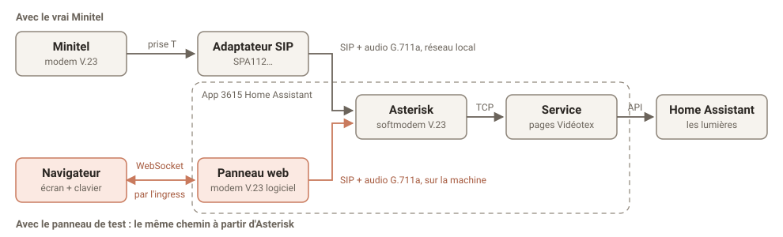

# 3615 Home Assistant

Le Minitel appelle Home Assistant par sa ligne téléphonique, à travers un adaptateur SIP, et affiche un tableau de bord de Home Assistant, à jour en direct. On tape un numéro puis ENVOI pour allumer une lumière, ouvrir un volet ou lancer une scène.

```
Minitel ── prise T ── adaptateur SIP ── cette app (Asterisk + softmodem V.23 + serveur Vidéotex) ── Home Assistant
```

## Il vous faut

- Un Minitel, avec sa fiche téléphonique en T.
- Un adaptateur téléphonique analogique (ATA) qui parle SIP et G.711a, par exemple un Cisco SPA112.
- Une prise T **femelle** reliée à un RJ11 mâle : un adaptateur tout fait, ou une prise murale en T câblée à la main.

## Configuration

Le mot de passe SIP est obligatoire : sans lui, la configuration ne s'enregistre pas. Le plus simple est de tout saisir d'un coup en mode YAML (⋮ > Modifier en YAML) :

```yaml
title: 3615 MAISON
dashboard: ""
sip_password: ChoisissezUnMotDePasse42
lan_cidr: ""
```

| Option | Rôle |
|---|---|
| `title` | Affiché en haut de chaque écran. |
| `dashboard` | Le tableau de bord de Home Assistant à afficher. Vide : celui par défaut. Voir ci-dessous. |
| `sip_password` | Lettres et chiffres uniquement. À reporter dans l'adaptateur. |
| `lan_cidr` | Réseau autorisé à s'enregistrer sur Asterisk, par exemple `192.168.1.0/24`. Vide : le réseau de l'interface par défaut. |

Au démarrage, l'onglet Journal de l'app affiche le réseau autorisé, le tableau de bord choisi, ce qui n'a pas pu en être repris, puis `en écoute sur 127.0.0.1:3615`.

### Le tableau de bord

Sans réglage, le Minitel affiche le **tableau de bord par défaut** de Home Assistant (Paramètres > Tableaux de bord). Le tableau de bord intégré, que Home Assistant compose lui-même, ne se lit pas : dans ce cas, le Minitel fait une page par pièce, ses entités rangées par type.

Un tableau de bord pensé pour l'écran de 40 colonnes donne un bien meilleur résultat. Le plus simple : dans Paramètres > Tableaux de bord, dupliquer un tableau de bord existant, garder l'essentiel, puis reporter son adresse dans l'option `dashboard`. Pour `http://homeassistant.local:8123/maison-minitel/salon`, c'est `maison-minitel` ; l'adresse entière marche aussi. Il peut rester caché de la barre latérale.

Les modifications du tableau de bord arrivent sur le Minitel en direct, sans redémarrer l'app.

| Dans Home Assistant | Sur le Minitel |
|---|---|
| les vues | le sommaire, une rubrique par vue (les sous-vues n'y sont pas) |
| une vue trop longue | plusieurs écrans, avec SUITE / RETOUR |
| carte Titre, titre d'une carte Entités ou d'une grille | titre de section, avec ses pastilles à droite (la température de la pièce…) |
| carte Tuile, Bouton, Entité, Thermostat, lignes d'une carte Entités | une ligne : le nom, l'état à droite |
| carte Coup d'œil, pastilles de la vue | des valeurs sur deux colonnes |
| carte Capteur | la valeur en grand ; avec un graphique, une courbe |
| carte Graphique d'historique ou de statistiques, `mini-graph-card` | une courbe pour la première entité, les autres en lignes |
| carte Jauge | la valeur en grand sur une jauge, relevée toutes les 10 s |
| piles, grilles, carte conditionnelle | leur contenu, à plat |
| visibilité selon un état (une section « porte ouverte ») | la section apparaît et disparaît sur le Minitel |
| cartes tierces (`custom:`) qui nomment leurs entités | une ligne par entité |
| `auto-entities`, statistiques, cartes, images, listes, raccourcis | ignorés, et signalés dans le journal |

Le nom vient de la carte (`name`), sinon de l'entité. Le Minitel n'a pas de majuscules accentuées : `É` s'affiche `E`. Les minuscules accentuées passent.

#### Les courbes

Une courbe couvre la durée de sa carte (`hours_to_show`, ou `days_to_show`) en 68 points, sur quatre rangées en mosaïque. Au-dessus, son nom et sa valeur actuelle. À droite, l'axe, avec le haut et le bas de l'échelle. En dessous, la durée couverte : `-15 min ............... maintenant`.

Elle part de l'historique de Home Assistant, puis défile : le point le plus récent est toujours contre l'axe, et tout glisse d'un cran vers la gauche à chaque point. Chaque point redessine la courbe, environ 160 octets, plus d'une seconde de ligne : il n'y a donc jamais plus d'un point toutes les 5 secondes.

Les fractions d'heure sont acceptées : `hours_to_show: 0.25` donne un quart d'heure, un point toutes les 13 secondes. Pour une courbe courte (au plus 30 secondes par point, soit `hours_to_show: 0.56` ou moins), le Minitel demande à Home Assistant de relever l'entité à chaque point, tant que la courbe est à l'écran. Home Assistant ne relève pas une même intégration plus d'une fois toutes les 10 secondes : une courbe plus fine que ça ne montre que des paliers.

#### Les jauges

Une carte Jauge prend trois rangées : son nom et sa valeur en double taille, puis une barre sur presque toute la largeur, entre le `min` et le `max` de la carte. Tant qu'elle est à l'écran, le Minitel demande à Home Assistant de relever son entité toutes les 10 secondes. C'est ce qu'il faut pour un débit ou une puissance en direct ; ne mettez pas en jauge l'entité d'un service en ligne, qui limite ses requêtes.

## Le branchement

Le Minitel a une fiche T mâle, et l'adaptateur une prise RJ11. Il faut une prise T **femelle** reliée à un RJ11 mâle :

```
Bornes 1 et 3 de la prise T  ───  les deux fils centraux du RJ11
```

Les deux fils peuvent être inversés. Les autres bornes restent vides.

**Ne branchez pas l'adaptateur à l'arrière de la fiche du Minitel.** Cette prise gigogne semble marcher : l'adaptateur voit le décroché et l'appel part. Mais le Minitel l'isole en se connectant, il n'entend jamais la porteuse, et le `C` clignote 40 secondes avant de revenir à `F`.

## Réglages de l'adaptateur

C'est l'étape dont tout dépend. L'adaptateur doit appeler l'Asterisk de l'app, et transmettre le signal du modem sans le retoucher : le moindre traitement audio suffit à rendre la liaison illisible.

### Ce qu'il faut, quel que soit l'adaptateur

- **Un compte SIP enregistré sur Home Assistant :** serveur (Proxy, Registrar) = l'adresse IP de Home Assistant, port 5060 en UDP, utilisateur `minitel`, mot de passe = le `sip_password` de l'app. Donnez une adresse fixe à Home Assistant (réservation DHCP sur la box), sinon l'adaptateur la perdra.
- **Le G.711a (PCMA, A-law) seul :** pas de G.711u, pas de G.729, aucun autre codec.
- **Aucun traitement audio :** annulation d'écho et suppression de silence (VAD) coupées.
- **Une gigue fixe et basse**, sans ajustement automatique du tampon.
- **Fax coupé :** détection et relais. Le modem émet du 2100 Hz, que l'adaptateur prendrait pour un fax.
- **Un plan de numérotation qui appelle le 3615 dès le décroché** : voir [Numérotation](#numérotation).
- **Le même réseau local que Home Assistant :** Asterisk refuse tout ce qui est hors de `lan_cidr`.

### Pas à pas sur un Cisco SPA112

1. Branchez le port Internet de l'adaptateur sur la box, et un téléphone sur Phone 1 pour la mise au point.
2. Ouvrez son interface web, identifiants par défaut `admin` / `admin`. Son adresse s'obtient avec le téléphone : composez `****`, puis `110#`, et l'adaptateur l'énonce. Si l'interface ne répond pas depuis la box, branchez un PC sur son port Ethernet : elle répond alors sur `http://192.168.15.1`.
3. Allez dans **Voice > Line 1**, et remplissez ces champs (si l'un manque, passez en vue avancée) :

   | Section | Réglage | Valeur |
   |---|---|---|
   | | Line Enable | yes |
   | Network Settings | Network Jitter Level | low |
   | | Jitter Buffer Adjustment | no |
   | Proxy and Registration | Proxy | adresse IP de Home Assistant |
   | | Register | yes |
   | Subscriber Information | User ID | `minitel` |
   | | Password | le `sip_password` de l'app |
   | Audio Configuration | Preferred Codec | G711a |
   | | Use Pref Codec Only | yes |
   | | Silence Supp Enable | no |
   | | Echo Canc Enable | no |
   | | FAX CNG Detect Enable | no |
   | | FAX Passthru Method | None |
   | | Modem Line | yes |
   | Dial Plan | Dial Plan | `(<:3615>S0)` |

4. Cliquez sur **Submit**. Dans **Voice > Info**, la *Registration State* de Line 1 doit passer à *Registered*. Sinon, voir [le dépannage](#dépannage).
5. Débranchez le téléphone, branchez le Minitel sur Phone 1, et appuyez sur CONNEXION/FIN.

### Numérotation

Un Minitel 1 n'a pas de numéroteur, et les chiffres tapés s'affichent seulement à l'écran. Le Dial Plan `(<:3615>S0)` appelle le 3615 dès le décroché : CONNEXION/FIN suffit, et la ligne ne sert plus qu'au Minitel. Pour composer depuis un téléphone branché sur la ligne, utiliser `(3615S0|[0-9]x.)`, puis appuyer sur CONNEXION/FIN en entendant le modem.

### Adaptateur d'occasion

Il peut encore contenir le compte SIP de son ancien propriétaire : vérifiez Line 1 et Line 2, désactivez la ligne inutilisée, et changez le mot de passe d'administration.

## Sur le Minitel

Le sommaire liste les vues du tableau de bord : tapez un numéro puis ENVOI. Dans une vue, chaque entité qu'on peut commander a un numéro ; les capteurs n'en ont pas. L'écran se met à jour tout seul quand un état change.

| Touche | Effet |
|---|---|
| CONNEXION/FIN | appelle, puis raccroche |
| numéro + ENVOI | allume ou éteint, ouvre ou ferme, lance une scène ou un script, passe à l'option suivante |
| numéro + SUITE / RETOUR | plus ou moins : lumière, consigne de chauffage, position d'un volet, volume. Le numéro reste saisi : appuyez encore |
| SUITE / RETOUR | écran suivant / précédent, puis la vue voisine |
| SOMMAIRE | le sommaire |
| GUIDE | l'aide des touches |
| RÉPÉTITION | redessine l'écran |
| CORRECTION / ANNULATION | efface un chiffre / toute la saisie |

Une serrure demande ENVOI une seconde fois. `HS` signale une entité indisponible ou inconnue. Quand Home Assistant ne répond plus, la rangée tout en haut de l'écran l'indique. Sans activité, l'appel raccroche au bout de 10 minutes.

## Tester sans Minitel

L'app ajoute un panneau **Minitel** dans la barre latérale (administrateurs seulement) : un Minitel dans le navigateur, avec son écran et son clavier. Appuyez sur **Connexion/Fin** pour appeler le 3615.

L'appel suit le chemin du vrai Minitel, sauf le fil : un modem V.23 logiciel appelle Asterisk en SIP, et passe par le softmodem et le service jusqu'à Home Assistant. Si le panneau marche et pas le vrai Minitel, cherchez du côté de l'adaptateur ou du branchement. Comme sur le vrai, les touches partent à 75 bauds : elles mettent un instant à arriver.



Le navigateur ne fait qu'afficher l'écran et envoyer les touches. Tout le reste se passe dans l'app, comme pour un vrai appel.

Le clavier de l'ordinateur marche aussi : lettres et chiffres, Entrée = Envoi, Retour arrière = Correction, Échap = Annulation, Page suivante / précédente = Suite / Retour, Début = Sommaire, F10 = Connexion/Fin.

Le panneau a son propre compte SIP, joignable seulement depuis la machine, avec un mot de passe tiré à chaque démarrage : il ne déloge pas l'adaptateur. Un seul panneau peut être en ligne à la fois. Ce qui est commandé depuis le panneau l'est pour de vrai.

## Réseau

L'app utilise le réseau de l'hôte : 5060/udp pour le SIP et 10100-10120/udp pour l'audio. Le panneau écoute sur 3616/tcp, mais ne répond qu'au proxy ingress de Home Assistant. Le service Vidéotex n'écoute que sur `127.0.0.1` : il n'a pas d'authentification. L'accès à Home Assistant passe par le Supervisor (API WebSocket), sans jeton à créer.

## Dépannage

- **L'adaptateur ne s'enregistre pas :** le journal de l'app montre `did not pass ACL test` si l'adaptateur est hors de `lan_cidr`. Sinon, vérifiez User ID et mot de passe. Après un redémarrage de l'app, l'adaptateur ne se réenregistre qu'à l'échéance de son délai : redémarrez-le pour aller plus vite.
- **`C` clignotant 40 s puis retour à `F` :** l'appel arrive, mais le Minitel n'entend pas la porteuse. Vérifiez d'abord le branchement, puis les traitements audio de l'adaptateur. Si rien n'y fait, le niveau de la porteuse est peut-être à ajuster : voir [Développement](https://github.com/enavarro222/3615HomeAssistant/blob/main/DEVELOPPEMENT.md#niveau-de-la-porteuse).
- **Caractères incohérents :** annulation d'écho ou suppression de silence encore actives. Une sauvegarde ou une compilation lourde sur la machine pendant l'appel peut aussi en causer : l'app tourne sur la même machine que Home Assistant.

## Limites

- Jusqu'à 4 adaptateurs, sur le même compte `minitel` et le même mot de passe. Plusieurs Minitel en ligne en même temps n'ont pas encore été testés.
- Pas d'alarme : un `alarm_control_panel` s'affiche, mais ne se commande pas (il faudrait taper son code).

La version Docker sans Home Assistant OS, les tests et les outils de diagnostic sont décrits dans [Développement](https://github.com/enavarro222/3615HomeAssistant/blob/main/DEVELOPPEMENT.md).
